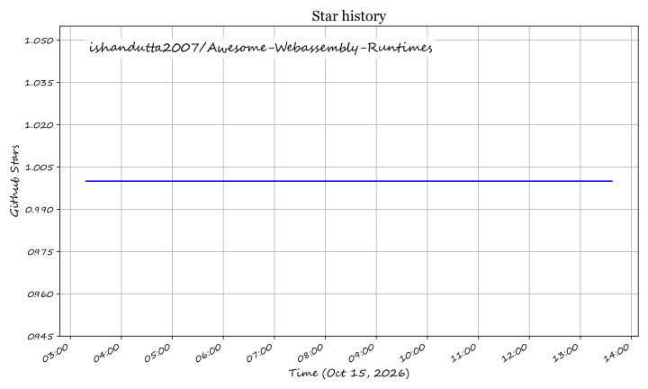

# ⚡ Awesome WebAssembly Runtimes

  

  
  
  
  
  
  

---

## 📖 Overview

A definitive, community-curated list of **WebAssembly (Wasm) Runtimes**, **Serverless Edge Platforms**, **Execution Engines**, and **WASI Tooling**. 

WebAssembly is moving far beyond web browsers. Server-side and edge Wasm provides near-instant cold starts (measured in microseconds), hardware-level capability sandboxing, tiny memory footprints, and language-agnostic portability across Linux, macOS, Windows, and embedded microcontrollers.

Whether you are evaluating stand-alone JIT engines (`Wasmtime`, `Wasmer`), cloud-native service meshes (`WasmEdge`), ultra-compact embedded interpreters (`wasm3`, `WAMR`), or global edge compute clouds (`Cloudflare Workers`, `Fastly Compute`), this guide provides technical comparisons, commercial pricing, free-tier limits, and real-time popularity metrics.

---

## 📑 Table of Contents

- [🌐 Sector Overview & Market Dynamics](#-sector-overview--market-dynamics)
- [☁️ SaaS & Hosted Wasm Platforms](#️-saas--hosted-wasm-platforms)
- [🛠️ Open-Source GitHub Projects](#️-open-source-github-projects)
- [🧭 Architectural Decision Matrix](#-architectural-decision-matrix)
- [🤝 How to Contribute](#-how-to-contribute)
- [📈 Star History](#--star-history)
- [💖 Support & Contributing](#-support--contributing)
- [📜 Disclaimer](#-disclaimer)

---

## 🌐 Sector Overview & Market Dynamics

> **Market Size & Growth**: The global WebAssembly & serverless edge compute market was valued at **$5.2 Billion in 2024** and is projected to expand to **$26.8 Billion by 2032**, demonstrating a robust compound annual growth rate (**CAGR of ~22.8%**). Demand is driven by microservice cold-start reduction, secure multi-tenant plugin sandboxing, and ultra-low-latency edge AI inference.

> **Market Concentration**: The sector is currently **moderately fragmented**. High-bandwidth edge content delivery and global request routing are led by established edge CDN providers (Cloudflare, Fastly), while the server-side runtime, WASI standardization, container shims, and distributed component orchestration layers remain highly dynamic, contested, and innovated by dedicated open-source startups (Fermyon, Wasmer, Cosmonic) working alongside the Bytecode Alliance and CNCF.

---

## ☁️ SaaS & Hosted Wasm Platforms

The following hosted platforms and managed cloud runtimes offer turnkey WebAssembly execution outside the browser. Entries are sorted descending by company size (valuation or market capitalization).

| 🏢 Platform / Service | 💼 Company & Valuation / Revenue | ⚡ Key Capabilities & Execution Model | 💳 Starting Tier Pricing | 🎁 Free Tier / Free Trial Limits |
| :--- | :--- | :--- | :--- | :--- |
| **[Cloudflare Workers](https://workers.cloudflare.com/)** | Cloudflare, Inc. (NYSE: NET) • **$35.2B Market Cap** • $1.3B+ Annual Revenue | V8-based isolates with first-class Wasm compilation, global edge network across 330+ cities, KV storage, and sub-millisecond cold starts. | **$5.00 / month** (Workers Paid includes 10M requests/mo + $0.30 per additional million requests) | **Free forever**: • 100,000 requests / day • 10ms CPU time / request • Up to 100 worker scripts |
| **[Docker Wasm](https://docs.docker.com/desktop/wasm/)** | Docker, Inc. • **$2.1B Valuation** • $150M+ ARR | Container ecosystem integration running Wasm/WASI workloads alongside standard OCI containers via containerd and `runwasi`. | **$5.00 / user / month** (Docker Pro billed annually at $60/yr or $7/mo monthly; includes advanced developer tooling) | **Free forever** (Docker Personal): • Unlimited local Wasm engine execution • 200 container pulls / 6 hours • 1 private repository |
| **[Fastly Compute](https://www.fastly.com/products/edge-compute)** | Fastly, Inc. (NYSE: FSLY) • **$1.12B Market Cap** • $506M Annual Revenue | Standalone compiled WebAssembly execution based on Lucet/Wasmtime, delivering instant 35-microsecond cold starts at 100+ POPs. | **$50.00 / month** (Or pay-as-you-go starting at $0.0000005/request + $0.00002/CPU-sec) | **Free recurring credit**: • $50 / month recurring usage credit (equivalent to ~100M requests or ~2.5M CPU-sec) |
| **[Fermyon Cloud](https://www.fermyon.com/cloud)** | Fermyon Technologies, Inc. • **$30M Valuation** • $20M Series A raised | Purpose-built hosted serverless platform for Spin Wasm applications, key-value storage, SQLite integration, and edge AI inferencing. | **$10.00 / month** (Developer Tier includes 50 apps, 15M requests/mo, custom domains, and managed DB) | **Free forever**: • 5 active applications • 100,000 requests / month • 1 GB outbound bandwidth |
| **[Wasmer Cloud](https://wasmer.io/products/edge)** | Wasmer Inc. • **$15M Valuation** • $4.2M Seed raised | Universal cloud deployment running Wasm packages, WASIX extended POSIX syscalls, edge databases, and automatic global TLS domains. | **$12.00 / month** (Wasmer Pro includes 10M requests/mo, 50GB data transfer, and custom domains) | **Free forever**: • 3 published apps • 1,000,000 requests / month • 10 GB bandwidth & shared CPU |
| **[Cosmonic](https://cosmonic.com/)** | Cosmonic Corp. • **$12M Valuation** • $8.5M Seed raised | Managed distributed application platform based on CNCF wasmCloud; connects actor components across edge, hybrid, and multi-cloud nodes. | **$20.00 / month** (Pro Developer Plan includes multi-cloud constellations, custom domains, and auto-scaling) | **30-day free trial**: • 2 connected infrastructure hosts • 25 actor/component instances • 250 MB data transfer limit |
| **[Second State Flows.network](https://flows.network/)** | Second State Inc. • **$8M Valuation** • $4M Seed raised | Serverless WasmEdge execution platform automating AI agent workflows, GitHub automation, and event-driven LLM pipelines. | **$9.00 / user / month** (Developer Tier includes 100 active flows, unlimited triggers, and priority execution) | **Free forever**: • 5 active automation flows • Up to 1,000 monthly event executions • Standard community webhooks |

---

## 🛠️ Open-Source GitHub Projects

Curated open-source WebAssembly execution engines, runtimes, intermediate compilers, and standardization toolchains. **Sorted descending by real-time GitHub Stars_Count**.

1. **[Wasmer](https://github.com/wasmerio/wasmer)**   
   🚀 Ultra-fast and lightweight WebAssembly runtime supporting multiple compiler backends (Cranelift, LLVM, Singlepass), WASIX extensions for full POSIX compatibility, and universal binary compilation.

2. **[Wasmtime](https://github.com/bytecodealliance/wasmtime)**   
   ⚡ The standalone JIT WebAssembly runtime from the Bytecode Alliance. Industry benchmark for WASI implementation, high-security capability sandboxing, and official Wasm Component Model support.

3. **[AssemblyScript](https://github.com/AssemblyScript/assemblyscript)**   
   🟦 TypeScript-like programming language designed specifically for compiling strictly-typed code directly into lightweight WebAssembly binaries.

4. **[TinyGo](https://github.com/tinygo-org/tinygo)**   
   🐹 Go compiler optimized for constrained environments, microcontrollers, and ultra-compact WebAssembly / WASI builds with minimal runtime overhead.

5. **[WasmEdge](https://github.com/WasmEdge/WasmEdge)**   
   🌐 CNCF-hosted, lightweight, high-performance WebAssembly runtime optimized for cloud-native edge computing, Kubernetes sidecars, and hardware-accelerated AI/LLM inference.

6. **[wasm-bindgen](https://github.com/rustwasm/wasm-bindgen)**   
   🦀 Facilitates seamless, zero-copy high-level interactions between Rust data structures and WebAssembly host environments.

7. **[Binaryen](https://github.com/WebAssembly/binaryen)**   
   ⚙️ WebAssembly compiler and toolchain infrastructure library providing comprehensive dead-code elimination, performance optimization, and IR generation passes.

8. **[WABT (WebAssembly Binary Toolkit)](https://github.com/WebAssembly/wabt)**   
   🧰 The canonical tool suite for manipulating Wasm files, including `wasm2wat`, `wat2wasm`, `wasm-interp`, `wasm-objdump`, and `wasm-decompile`.

9. **[wasm3](https://github.com/wasm3/wasm3)**   
   🚀 The fastest WebAssembly interpreter in existence. Fully portable C99 engine with zero JIT compilation lag, running on Arduino, ESP32, Raspberry Pi, iOS, and embedded chips.

10. **[Spin](https://github.com/spinframework/spin)**   
    🌀 Open-source developer framework and CLI by Fermyon for building, testing, and deploying microservices and event-driven functions using WebAssembly components.

11. **[wazero](https://github.com/tetratelabs/wazero)**   
    🟢 Pure Go WebAssembly runtime with zero CGO dependencies and full WASI support, making Go application embedding effortless and totally portable.

12. **[WAMR (WebAssembly Micro Runtime)](https://github.com/bytecodealliance/wasm-micro-runtime)**   
    🔬 Ultra-small-footprint runtime from the Bytecode Alliance configurable as an interpreter, JIT, or AOT compiler for resource-constrained IoT devices.

13. **[Extism](https://github.com/extism/extism)**   
    🔌 Universal WebAssembly plugin framework providing unified Host SDKs across 16+ programming languages to securely execute untrusted guest plugins.

14. **[Lunatic](https://github.com/lunatic-solutions/lunatic)**   
    🌕 Erlang-inspired, actor-based runtime for WebAssembly combining preemptive scheduling, lightweight isolated processes, and fault-tolerant supervision trees.

15. **[wasmCloud](https://github.com/wasmCloud/wasmCloud)**   
    ☁️ CNCF application runtime that lets developers compose portable WebAssembly actor components with decoupled capability providers across any infrastructure.

16. **[wasm-tools](https://github.com/bytecodealliance/wasm-tools)**   
    🔧 Low-level CLI utilities and Rust libraries for inspecting, validating, mutating, stripping, and composing WebAssembly binaries and components.

17. **[wit-bindgen](https://github.com/bytecodealliance/wit-bindgen)**   
    🧩 Multi-language binding generator for WebAssembly Interface Types (WIT), powering seamless inter-module communication in the Wasm Component Model.

18. **[runwasi](https://github.com/containerd/runwasi)**   
    🐳 Containerd runtime shim enabling Kubernetes, Nomad, and Docker clusters to execute WebAssembly workloads directly as native Pods and containers.

19. **[Chicory](https://github.com/dylibso/chicory)**   
    ☕ Native Java/JVM WebAssembly runtime with zero JNI bindings or native binary dependencies, bringing safe sandbox isolation into existing enterprise JVM applications.

---

## 🧭 Architectural Decision Matrix

| Requirement / Workload | Recommended Runtime | Rationale |
| :--- | :--- | :--- |
| **Production Server-Side Microservices** | **Wasmtime** or **Spin** | Strict WASI compliance, high JIT throughput with Cranelift, Component Model standards. |
| **Cross-Platform Universal Packaging** | **Wasmer** | Broadest OS support, WASIX for POSIX socket syscalls, integrated registry. |
| **Kubernetes & Cloud-Native Edge** | **WasmEdge** or **runwasi** | CNCF-aligned, containerd integration, hardware acceleration for LLMs (`wasi-nn`). |
| **Microcontrollers & Tiny IoT Devices** | **wasm3** or **WAMR** | Sub-megabyte binary footprint, interpreter mode with zero compilation overhead. |
| **Embed Sandboxed Plugins in Host Apps** | **Extism** | Prebuilt Host SDKs in Go, Rust, Python, Node.js, C#, PHP, Ruby, and Java. |
| **Pure Go Application Stacks** | **wazero** | Eliminates CGO dependency hurdles; pure Go compilation into a single static binary. |
| **Enterprise Java / JVM Integration** | **Chicory** | Pure JVM bytecode execution without native C++ libraries or OS architecture mismatch. |

---

## 🤝 How to Contribute

Contributions are warmly welcome! To add or update an entry:

1. 🍴 Fork this repository: [Awesome-Webassembly-Runtimes](https://github.com/ishandutta2007/Awesome-Webassembly-Runtimes)
2. 📝 Add or edit entries in `README.md` following the existing format.
3. 🔎 Provide official project links, concise technical descriptions, and factual pricing/limits.
4. 🚀 Open a Pull Request detailing the additions or updates.

Check out our curated meta-list at **[Awesome-Awesome-Awesome](https://github.com/ishandutta2007/Awesome-Awesome-Awesome)** for more top developer resources!

---

##  Star History

---

## 💖 Support & Contributing

Thank you for visiting and supporting **Awesome WebAssembly Runtimes**! 🙏

If you found this repository helpful for your projects, research, or architecture decisions, please consider supporting us:
- ⭐ **Star** this repository to help other developers and platform engineers discover it
- 🍴 **Fork & Share** with your teammates, communities, and developer networks
- 📬 Join discussions and connect on [Discord](https://discord.gg/jc4xtF58Ve)
- ☕ **Sponsor & Buy a Coffee**: Support ongoing research, updates, and open-source maintenance directly on the [GitHub Sponsors Dashboard](https://github.com/sponsors/ishandutta2007)

---

## 📜 Disclaimer

- This is a **community-curated** educational directory — not an official endorsement of any vendor or tool.
- WebAssembly isolation provides strong memory safety, but defense in depth remains essential. Restrict host capabilities granted through WASI interfaces, validate untrusted binaries, and keep your host runtimes updated.
- All product names, logos, and trademarks belong to their respective copyright holders.

## Star History

<a href="https://star-history.com/#ishandutta2007/Awesome-Webassembly-Runtimes&Timeline" align="center">
  <picture>
    <source media="(prefers-color-scheme: dark)" srcset="assets/ishandutta2007_Awesome-Webassembly-Runtimes_growth.svg">
    
  </picture>
</a>
